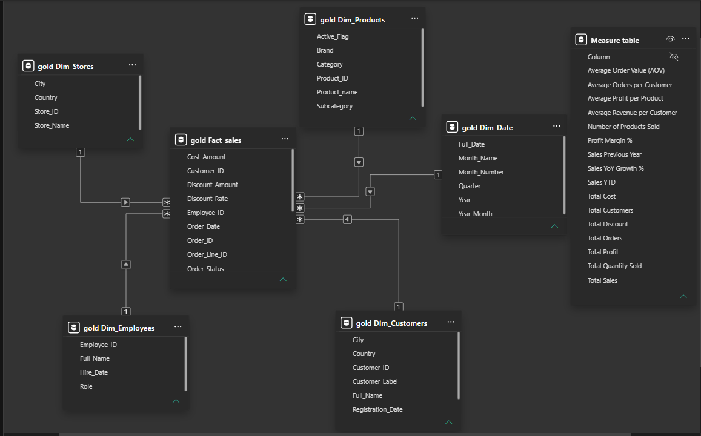
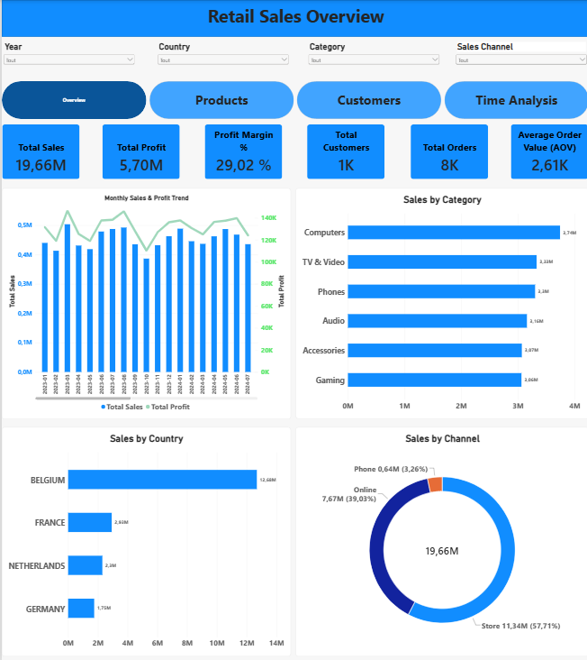
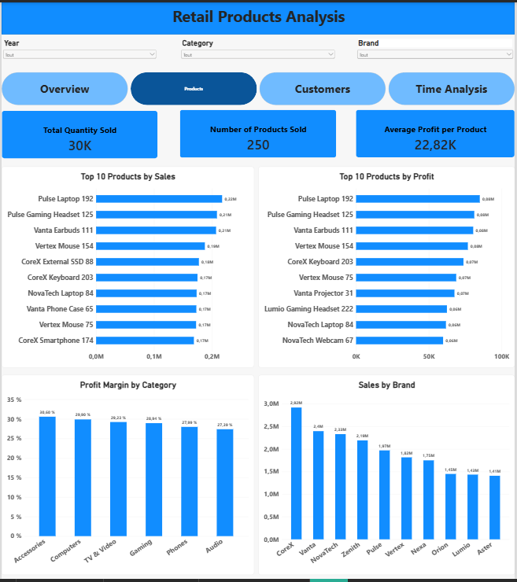
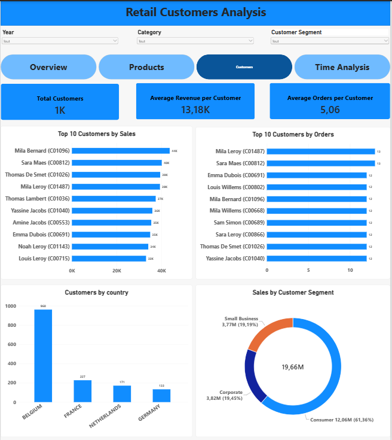
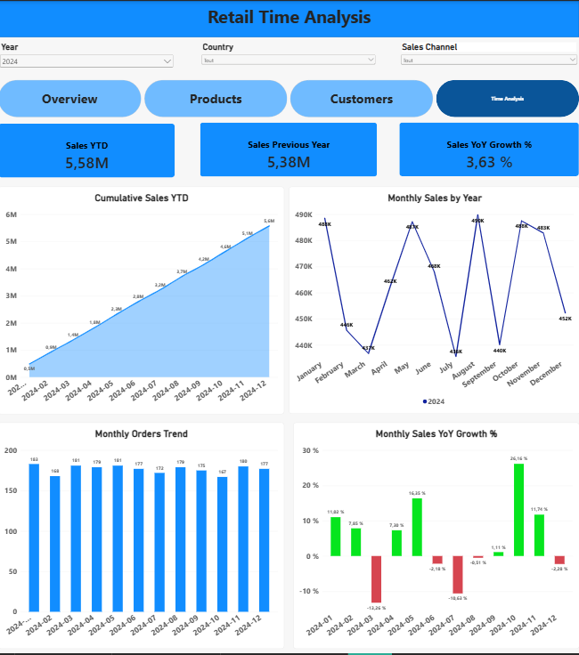

# Retail Analytics | SQL Server & Power BI

## Project Overview

This project demonstrates an end-to-end Business Intelligence workflow using SQL Server and Power BI.

The objective is to transform raw retail sales data into a structured analytical model and develop an interactive dashboard to monitor sales performance, profitability, products, customers, and trends over time.

**Note:** This project uses synthetic retail data for educational and portfolio purposes.

## Technologies Used

- **SQL Server / SSMS** — Data cleaning, transformation, and modeling
- **SQL** — Views, joins, CTEs, aggregations, and business calculations
- **Power BI** — Data modeling, interactive dashboards, and visualizations
- **DAX** — Business KPIs and time intelligence measures

## Data Architecture

The project follows a three-layer architecture:

**Bronze Layer — Raw Data**

Raw CSV files are imported into SQL Server without modifying their original values.

**Silver Layer — Data Cleaning**

SQL views clean and standardize the data, including:

- Removing unnecessary spaces
- Handling missing values
- Standardizing country names and categories
- Correcting inconsistent order statuses
- Converting columns to appropriate data types

**Gold Layer — Analytical Model**

Cleaned data is transformed into a star schema with one fact table and five dimension tables.

The fact table contains sales transactions at the order-line level, including calculated sales, costs, discounts, and profit.

## Star Schema

**Fact table:** `gold.Fact_sales`

**Dimension tables:**
- `gold.Dim_Customers`
- `gold.Dim_Products`
- `gold.Dim_Stores`
- `gold.Dim_Employees`
- `gold.Dim_Date`

## Power BI Dashboard

The report contains four interactive pages.

### 1. Sales Overview

Provides an overview of sales, profit, orders, customers, product categories, countries, and sales channels.

### 2. Products Analysis

Analyzes product performance, top-selling products, profitability, categories, and brands.

### 3. Customers Analysis

Examines customer purchasing behavior, top customers by sales and orders, customer segments, and geographic distribution.

### 4. Time Analysis

Tracks monthly sales, cumulative sales, order trends, and year-over-year growth.

## Key DAX Measures

The dashboard includes measures such as:

- Total Sales
- Total Profit
- Profit Margin %
- Total Orders
- Total Customers
- Average Order Value (AOV)
- Average Revenue per Customer
- Sales YTD
- Sales Previous Year
- Sales YoY Growth %

Financial KPIs are calculated using completed orders.

## Project Files

- `SQL/silver_views.sql` — Data cleaning and standardization
- `SQL/gold_views.sql` — Dimensional modeling and business calculations
- `POWER BI/dashboard_retails_analytics.pbix` — Power BI report
- `Images/` — Dashboard screenshots and star schema

## Project Purpose

This project was developed to demonstrate practical skills in SQL, data transformation, dimensional modeling, DAX, and Business Intelligence reporting.

The focus is on building a complete and structured analytics solution, from raw data preparation to interactive reporting.
